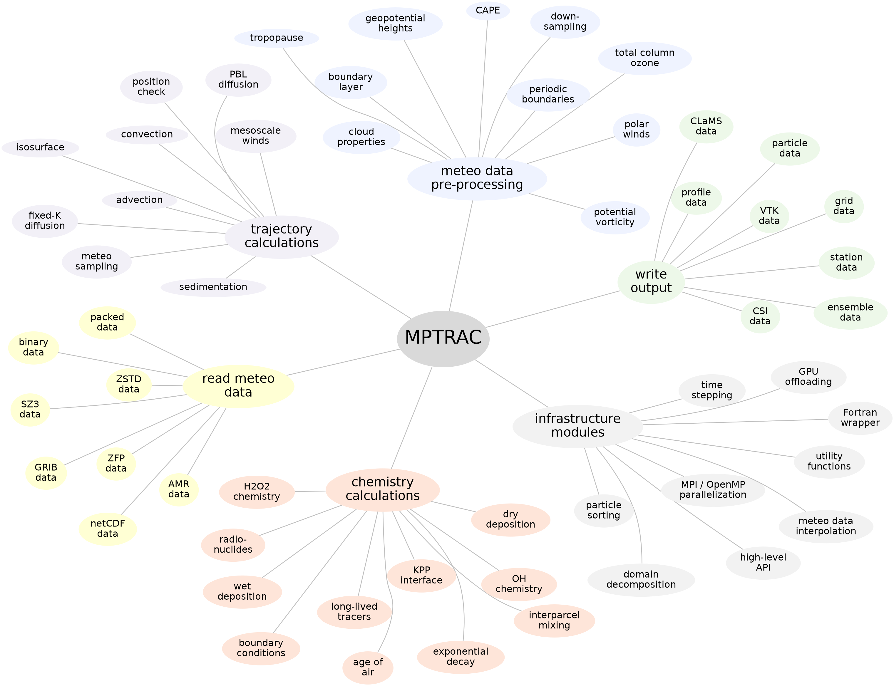

# Welcome to MPTRAC!

Massive-Parallel Trajectory Calculations (MPTRAC) is an open-source
Lagrangian transport and dispersion model for atmospheric air parcels.
Driven by meteorological reanalysis and forecast data, it follows
individual parcels through the atmosphere and represents transport,
dispersion, mixing, and selected physical and chemical processes.
MPTRAC is primarily designed for the free troposphere and stratosphere.

The model supports applications such as volcanic plume tracking,
wildfire emission transport, and studies of long-range atmospheric
transport. Its hybrid parallel implementation is designed for large
particle ensembles on multicore computers and GPU-based HPC systems.

## Key features

- **Lagrangian trajectories:** MPTRAC follows individual air parcels
  through meteorological wind and vertical velocity fields from
  reanalysis or forecast datasets. This particle-based approach is
  suited to investigating transport pathways, source–receptor
  relationships, and the evolution of atmospheric plumes.

- **Dispersion and mixing:** Stochastic parameterizations represent
  unresolved wind fluctuations and turbulent dispersion, including
  Langevin-based approaches. Optional inter-parcel exchange allows
  simulations to account for mixing between nearby air parcels.

- **Physical and chemical processes:** Modular parameterizations
  describe convection, sedimentation, radioactive or exponential
  decay, gas-phase and aqueous-phase chemistry, and wet and dry
  deposition. Processes can be selected according to the scientific
  application and the available input data.

- **Meteorological preprocessing:** MPTRAC derives additional fields
  from meteorological inputs, such as boundary-layer diagnostics,
  geopotential heights, convective indices, and tropopause
  information. These quantities support trajectory calculations and
  the optional physical process modules.

- **Output and analysis:** Simulations can produce particle
  trajectories, gridded distributions, ensemble statistics, vertical
  profiles, and sampling outputs. The results support subsequent
  visualization, comparison with observations, and quantitative
  transport analyses.

- **Parallel computing:** MPTRAC combines MPI, OpenMP, and OpenACC
  for execution on multicore CPUs and accelerators. MPI can distribute
  independent simulations or decompose a single particle simulation
  into spatial domains, enabling large-scale HPC applications.

- **Integration and open source:** The model provides a C high-level
  interface and a Fortran wrapper for coupling transport calculations
  to other software. Its source code is available under the GNU GPL
  v3, together with documentation and developer tools.

MPTRAC supports a broad range of transport studies, but individual
parameterizations have distinct assumptions and validation status.
In particular, planetary boundary-layer processes remain an active
development area. The [Model physics](model-physics.md) chapter
describes the available formulations.

## Getting started

The [Installation](installation.md) guide covers local and HPC
setups. Follow the [Quickstart](quickstart.md) to prepare a basic
trajectory simulation. For demonstrations or exploratory studies
without local installation, try the
[MPTRAC Web Runner](https://mptrac.jsc.fz-juelich.de).

## Explore the documentation

**Understand the model.** Start with [Model physics](model-physics.md)
for the transport and process parameterizations, or
[Diabatic transport](diabatic-transport.md) for the corresponding
vertical-coordinate approach. [Applications](applications.md)
provides examples of scientific workflows.

**Prepare and analyze simulations.** The user manual explains
[Control parameters](control-parameters.md),
[Meteorological input data](meteorological-input-data.md), and
[Model output data](model-output-data.md).

**Develop or extend MPTRAC.** The
[Developer manual](code-development.md) provides entry points to
[Code structure](code-structure.md),
[Building from source](building.md),
[Testing and code quality](testing.md), and
[Parallelization](parallelization.md).

## Citation and contributions

If you use MPTRAC in research, please consult the
[References](references.md) for relevant publications.
Source code, releases, and contribution guidelines are available in
the [GitHub repository](https://github.com/slcs-jsc/mptrac).

## Contact

Dr. Lars Hoffmann, <l.hoffmann@fz-juelich.de>  
Jülich Supercomputing Centre, Forschungszentrum Jülich, Germany
