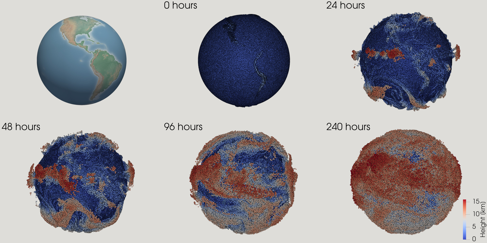

# Welcome to MPTRAC!

Massive-Parallel Trajectory Calculations (MPTRAC) is an open-source
Lagrangian transport and dispersion model for atmospheric air parcels.
Driven by meteorological reanalysis and forecast data, it follows
individual parcels through the atmosphere and represents transport,
dispersion, mixing, and selected physical and chemical processes.
MPTRAC is primarily designed for the free troposphere and stratosphere.

The model supports applications such as volcanic plume tracking,
wildfire emission transport, and studies of long-range atmospheric
transport. Its hybrid parallel implementation is designed for large
particle ensembles on multicore computers and GPU-based HPC systems.

## Key features

- **Lagrangian trajectories:** Calculates air parcel transport using
  horizontal winds and vertical velocities from meteorological
  reanalyses and forecasts.
- **Dispersion and mixing:** Represents unresolved wind fluctuations
  and diffusion, including Langevin-based parameterizations and
  optional inter-parcel mixing.
- **Physical and chemical processes:** Offers modules for convection,
  sedimentation, decay, gas-phase and aqueous-phase chemistry, and
  wet and dry deposition.
- **Meteorological preprocessing:** Derives supporting quantities,
  including boundary-layer diagnostics, geopotential heights,
  convective indices, and tropopause information.
- **Output and analysis:** Produces particle trajectories, gridded
  fields, ensemble statistics, profiles, and sampling outputs for
  subsequent analysis and visualization.
- **Parallel computing:** Combines MPI, OpenMP, and OpenACC for
  CPU and GPU execution, including MPI spatial domain decomposition.
- **Integration and open source:** Provides a C high-level interface
  and a Fortran wrapper and is distributed under the GNU GPL v3.

MPTRAC supports a broad range of transport studies, but individual
parameterizations have distinct assumptions and validation status.
In particular, planetary boundary-layer processes remain an active
development area. The [Model physics](model-physics.md) chapter
describes the available formulations.

## Getting started

The [Installation](installation.md) guide covers local and HPC
setups. Follow the [Quickstart](quickstart.md) to prepare a basic
trajectory simulation. For demonstrations or exploratory studies
without local installation, try the
[MPTRAC Web Runner](https://mptrac.jsc.fz-juelich.de).

## Explore the documentation

**Understand the model.** Start with [Model physics](model-physics.md)
for the transport and process parameterizations, or
[Diabatic transport](diabatic-transport.md) for the corresponding
vertical-coordinate approach. [Applications](applications.md)
provides examples of scientific workflows.

**Prepare and analyze simulations.** The user manual explains
[Control parameters](control-parameters.md),
[Meteorological input data](meteorological-input-data.md), and
[Model output data](model-output-data.md).

**Develop or extend MPTRAC.** The
[Developer manual](code-development.md) provides entry points to
[Code structure](code-structure.md),
[Building from source](building.md),
[Testing and code quality](testing.md), and
[Parallelization](parallelization.md).

## Citation and contributions

If you use MPTRAC in research, please consult the
[References](references.md) for relevant publications.
Source code, releases, and contribution guidelines are available in
the [GitHub repository](https://github.com/slcs-jsc/mptrac).

## Contact

Dr. Lars Hoffmann, <l.hoffmann@fz-juelich.de>  
Jülich Supercomputing Centre, Forschungszentrum Jülich, Germany
